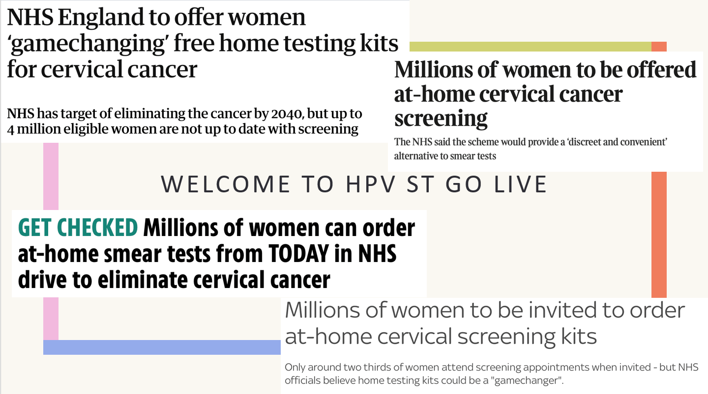
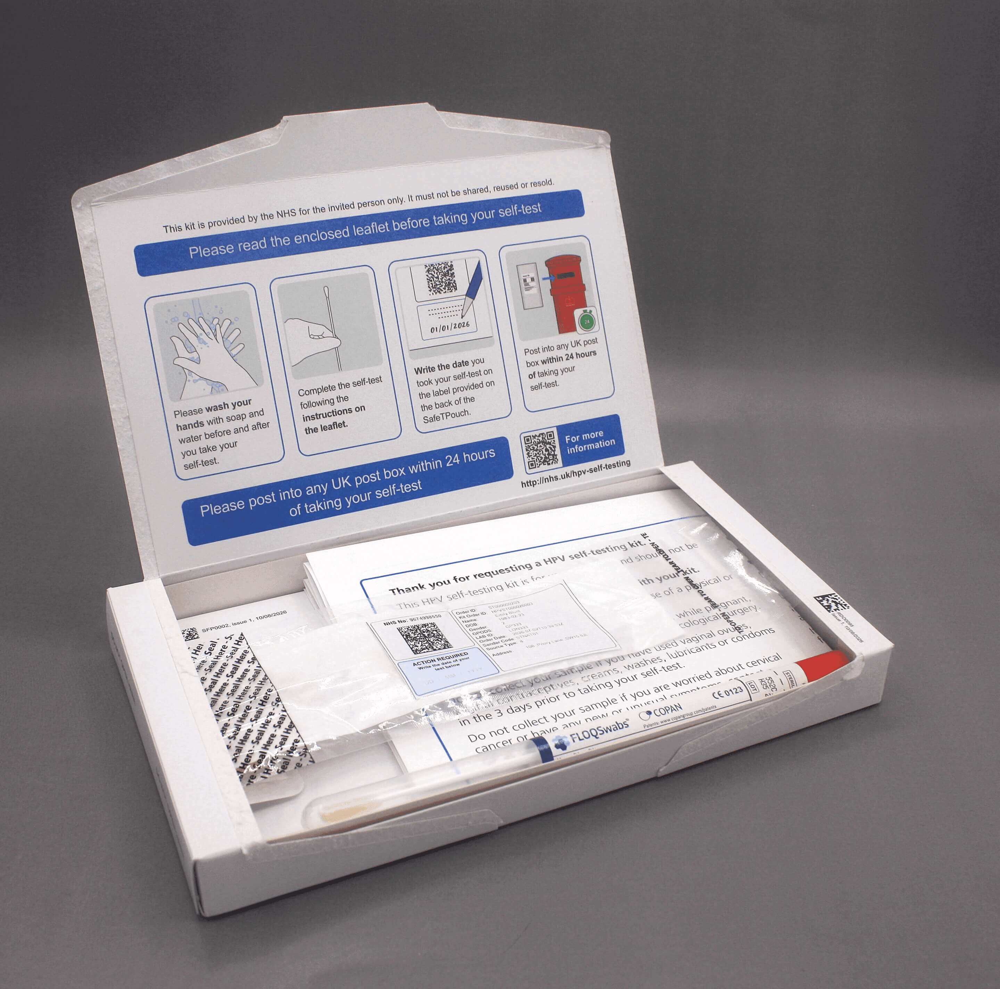

On the 25th August 2026 we began rolling out our new [HPV self-testing service](/hpv-self-testing/2025/05/project-context/). The service is aimed at people who do not attend or have not recently attended cervical screening. 

Many eligible people do not attend cervical screening appointments. Prior research has shown that some people face barriers to attending screening in person, including practical, emotional and accessibility related reasons. HPV self-testing aims to provide an alternative way to participate in screening by allowing people to take a sample at home. 

As part of the private beta, 200,000 people who have not responded to cervical screening are being invited to take part. 

## What is a private beta and why is it important? 
To quote [GOV.UK]( https://www.gov.uk/service-manual/agile-delivery/how-the-beta-phase-works) 
> The beta phase is where you … start building it for real… You’ll start in private beta by inviting a limited number of people to use your service.

This is the time to test our service in the real world with people who would use it. By doing this on a smaller scale, inviting 200,000 people rather than all 4 million people who have not responded to cervical screening, we can minimise risk and identify opportunities to improve the service. 
## What are we testing? 
A key part of a private beta is testing the full end-to-end journey. For HPV self-testing this includes at a high level:  

- invitation 
- reminder communications 
- ordering (online/offline) 
- kit fulfilment 
- receiving kit 
- understanding instructions 
- taking sample 
- returning kit 
- lab processing  
- result 
 
Invitations are going out via the NHS App, text message, email or letter respectively, and once invited you will be able to order a free kit through the NHS App or the telephone helpline. 

The self-testing kit contains a swab, which is used to collect a sample from the vagina. How you do the test depends on which type of test kit you have either Copan FLOQSwabs or Hologic Aptima. The sample is then posted back to the NHS for free, where it is checked for high-risk HPV. 

 
If high-risk HPV is found, people will be invited to book a follow-up cervical screening appointment at their GP surgery or sexual health clinic, where a healthcare professional will take a small sample from the cervix to check for cell changes. 

A problem at any point in this journey could affect someone's ability to complete the test. 
 
 
## What we are hoping to learn from the private beta
Before rolling out further, we need confidence that the service works for the people it is designed for. We are looking to test whether people can understand what HPV self-testing is, can complete each step of the journey successfully and whether the technology, processes and lab pathways work as intended. 
### Understanding the user journey 

- Do people understand why they've been invited?  
- Are they able to order a kit both online and offline? 
- Does the information give them enough confidence to use the kit?  
- Are people able to take samples that can be successfully processed and produce a result? 
- Are there problems that only appear when people use the real service? 

### Testing the technology 

- Do the data hand-offs between systems work?  
- Are the orders coming through? 
- Can the returned kits be processed?  
- Does the journey work from invitation through to result? 

### Accessibility 
- Is the telephone journey working effectively for people who cannot or choose not to use digital channels?  
- Are there people with access needs whose needs are not being met by the service? 
- What can we learn from speaking to people who've used the service? 
- What does further accessibility testing show? 

### Communications 

- Are the invitation methods effective?  
- Do people understand what they're being asked to do and why? 
  
## Reflections on our journey to private beta 

The roll-out of HPV self-testing is a step towards the NHS' ambition to eliminate cervical cancer by 2040. Around 4 million eligible people are not up to date with cervical screening. This service has the potential to help people who face barriers when attending screening in a clinical setting by enabling them to get tested in the comfort of their own home. 

As detailed in our [previous design histories](/hpv-self-testing/) , getting to this stage has involved user research, service design and content testing across the invitation, ordering, and kit return to result journey. Throughout successful discovery and alpha stages, and through to private beta, we used feedback from potential users and accessibility testing to improve the service. Private beta gives us the opportunity to validate those decisions in a real-world setting. 

This has been a hugely collaborative effort and wouldn’t have been possible without the dedicated HPV team, wider Screening Senior Leadership Team, Clinical Screening colleagues and colleagues from NHS Notify, NHS App and NHS.UK.  
  
### Key learnings: 
- Cross-teams collaboration is key to designing and building a service of this magnitude from scratch. If normally we are used to working on new features within an existing service, working on an entire new pathway – namely, non-responder pathway – brings together more stakeholders and teams than usual; teams that we have never worked with before, and vice-versa who are not used to working with digital delivery teams. Establishing a clear governance and sign-off process, as well as rapport and collaboration opportunities early on is what will ensure the success of the project. 

- When researching with hard-to-reach groups, from both a demographic representation and from an engagement with the NHS perspective, getting more creative with recruitment is what will ensure a representative mix of participants. In the beginning of our Alpha, it was crucial for us to first understand and map all our target sub-groups, to then know who we want to engage with. Calling our target group an umbrella term ‘non-responders’ can lead to misunderstandings or misconceptions about the people behind that term. Our research recruitment was done through a significant amount of outreach, building new connections with communities and their leaders, social prescribers and engaging the help with healthcare professionals and GP practices. 

- While we can define our own design and delivery timelines, when it comes to procurement delays, manufacturing challenges or new insights from our clinical safety or legal teams, sometimes things are out of our control. We learned the hard way, by having our private beta launch date delayed a few times. We now understand more about all these processes, what to avoid next time and what to start earlier. Spinning up a brand new service, first-of-type for the Cervical Screening pathway is no easy feat, and there’s a lot of moving parts that need to align and work together seamlessly. From a design perspective, we learned to look way beyond the participant journey, and have defined journeys for all our secondary or tertiary user groups, such as kit providers, mail couriers, laboratories, administrative staff, quality assurance staff, healthcare professionals, and so on. 

## Next steps 
Every day through the private beta we are gathering new data, insights and feedback from people using the service. We will use what we learn to understand what is working well, where people experience difficulties and what changes we need to make before any wider rollout. 

