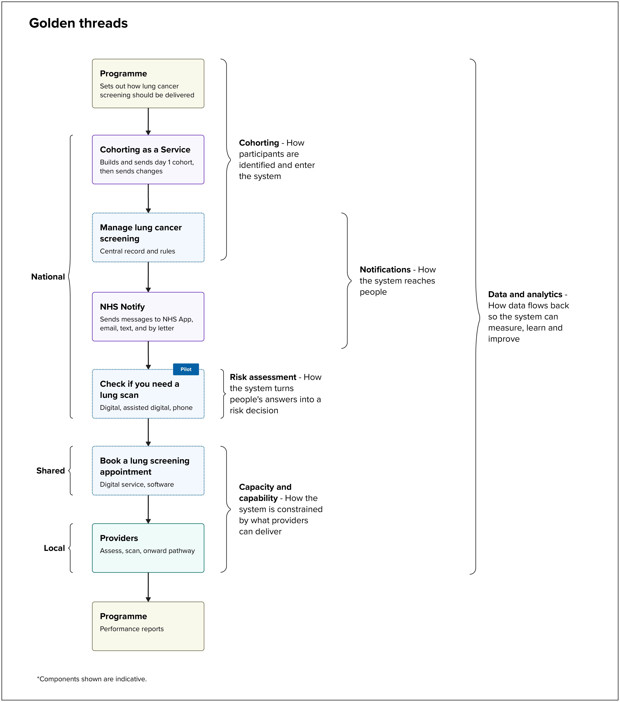

Many of the biggest problems in managing lung cancer screening are not inside any one service. They sit between different parts of the service.

In July, we ran workshops with the national lung cancer screening programme and our digital team. People kept describing problems that no single system could fix. Cohorts go out of date. People who opt out get invited again. Phone and digital risk results could differ. Invitations are sent manually, which makes it hard to balance them against CT scanner capacity. Data does not make it back to the people who need it.

Each of these problems depends on something moving through the whole service: a person, a message, an answer, a scanner appointment or a participant record. We call the routes these things take ‘golden threads’. A golden thread is something that has to work across the whole service, not just one part of it.

Following the threads changed the question we were asking. It stopped being ‘which system should we build?’ and became:

**Where should each thread be owned: nationally, shared or locally?**

## How lung cancer screening is run

Lung cancer screening is run differently from other screening programmes. The NHS screening directorate oversees several screening programmes, including breast, cervical, prostate, and diabetic eye screening.

The NHS cancer directorate owns the lung cancer screening programme. Cancer alliances deliver it locally, often in partnership with private providers using their own software.

This is why so many problems sit between different parts of the service, and why it matters who owns each thread.

## The 5 golden threads

Each thread has a central decision. These are policy and clinical decisions, not technical ones. The table sets out our proposals. None of them have been agreed yet.

We propose running 4 threads nationally. Capacity and capability stays shared and local, because providers know their local population, scanners and staff best.

| **Golden thread** | **What it follows** | **The central decision** | **Where we propose it sits** |
| --- | --- | --- | --- |
| Cohorting | How people are identified and enter the service | Whether GP smoking records are used to filter invitations, sort them, or not used at all | National: CaaS builds the cohort, and a new ‘Manage lung cancer screening’ service holds the record |
| Notifications | How the service reaches people | The order of channels (NHS App, text message, email or letter) and how invitations are standardised | National: Manage lung cancer screening sets the contact rules, and NHS Notify sends the messages |
| Risk assessment | How people’s answers become a risk decision | How answers are turned into calculator inputs, and who signs this off clinically | National: Check if you need a lung scan, one engine for digital, assisted digital and phone |
| Capacity and capability | How providers limit what the service can offer | What capacity information providers share: individual appointments or weekly totals per site | Shared booking (Book a lung screening appointment) and local providers |
| Data and analytics | How the service measures, learns and improves | What each audience needs to see, and how often | National: every step creates an event, and reports are built from those events |

## How the threads emerged

We set out to recommend how national digital services could best support lung cancer screening. To do that well, we needed to see the whole service, not just its separate parts.

In July, we ran 3 workshops with the programme, on digital risk assessment, data transfer and performance data. We also spoke to the programme and nearby teams, including the [Cohorting as a Service (CaaS)](https://digital.nhs.uk/services/cohorting-as-a-service-caas) team, about cohorting. Cohorting means working out who is eligible for screening.

We mapped what we heard into opportunity areas, which showed where the current service falls short. The same issues kept appearing at every stage, so we drew a map for each one. Each map showed what flows through the service, the central decision, and the questions our team needs to answer.

Risk assessment could look like a single service, but we treated it as a thread from the start. People will be able to complete it online, with help from provider staff (assisted digital), or by phone, and all 3 routes need to give the same result. We piloted a digital risk assessment between April and October 2026.

The risk assessment also relies on a combined calculator made outside the NHS. It is based on the Liverpool Lung Project (LLP) model and the Prostate, Lung, Colorectal, and Ovarian (PLCO) cancer screening trial model. The tool does not ask every question each model uses, so some answers are set to default values. Turning people’s answers into something the calculator can use is part of a Software as a Medical Device (SaMD), so it needs clinical sign-off.

In September, we shared the threads with the screening and cancer directorates. We agreed to work together as partners and shape the service jointly, rather than the digital team being handed requirements to build.

In October, we traced every workshop finding to a thread. We also compared breast, diabetic eye, and lung screening against the 5 threads.

## Why this matters

Getting the threads right means people get the same risk result no matter how they complete the assessment, and the same rules apply wherever they live. It also makes gaps visible, such as who is missed because their GP record has no smoking code, or because a message did not reach them.

For the programme, the threads turn a complex service into a few clear decisions that we can trace back to evidence. For other screening programmes, they offer a simple way to compare how different delivery models work.

## What we’re doing next

We will focus on the national parts of the service. We will look at:

- how we might build a cohort based on age alone
- what systems we need to manage that cohort, including how we reconcile our data with people who are already at various stages of lung cancer screening
- how we might invite people through NHS Notify, at a pace our provider partners can manage
- what the next version of the risk assessment might look like

At first, we may plan or build these pieces separately. We aim to join them up into one service during 2027.

We are writing a paper for the NHS cancer programme board meeting in November. It sets out our approach and asks the board to agree.

In our next post, we will share what following the threads taught us, and the quick wins we are proposing.
