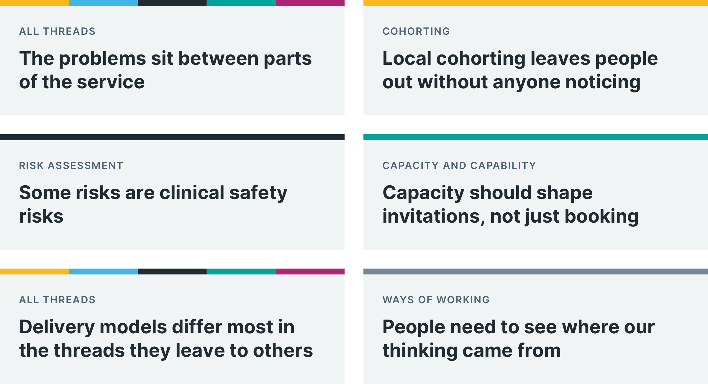

In [our last post](/lung-health-check/2026/11/following-the-golden-threads/), we explained how 5 golden threads emerged from workshops with the national [lung cancer screening](https://www.digital-prevention-services.nhs.uk/screening/lung/) programme. A golden thread is something that has to work across the whole service, not just one part.

This post covers what following the threads taught us, and what we are doing about it.

## What we learnt

### The problems sit between parts of the service

Data transfer fed every thread. Every thread depends on information moving from one part of the service to another. This was the earliest sign that designing one part at a time would not fix the problems people described.

### Local cohorting leaves people out without anyone noticing

Providers use different processes and code combinations to find eligible people. Some areas invite only people with a smoking code in their GP record. People with missing codes are excluded without anyone knowing.

The [SUMMIT study](https://www.uclh.nhs.uk/our-services/find-service/cancer-services/summit-study) found self-reported smoking status matched GP records for about 75% of people. The answers people give in the risk questionnaire will be better data for later rounds than GP records.

### Some risks are clinical safety risks

The risk assessment has 3 stages. The first collects people’s answers. The second turns those answers into the inputs the calculator needs. The third calculates their risk.

Some of the changes in the second stage are technical, such as converting date of birth to age. Others need clinical judgement, such as how to count years smoked, or how to score ‘do not know’ responses.

If the phone and digital routes calculate risk differently, people could be wrongly included or excluded. Keeping them the same is a clinical safety issue, not just a consistency one.

### Capacity should shape invitations, not just booking

Invitations are sent manually, which makes it hard to balance them against CT scanner capacity. The [lung cancer screening protocol](https://www.england.nhs.uk/wp-content/uploads/2019/02/2502-B1646-standard-protocol-prepared-for-the-lung-cancer-screening-programme.pdf) (PDF only, 878 KB) says people should be offered a scan within 56 days of their risk assessment. If invitations are sent faster than providers can scan, participants have to wait.

Follow-up scans at 3, 12 and 24 months also use future capacity. A plan that only counts the first round of scans will fail by year 3.

### Delivery models differ most in the threads they leave to others

We compared breast, diabetic eye, and lung screening against the 5 threads. Lung screening’s locally assembled model meant that mobile CT scanning capacity could be scaled quickly. Its weaker areas were cohorting, notifications, risk assessment, and data and analytics. These are the 4 threads we propose running nationally.

### People need to see where our thinking came from

The programme wanted to know how the workshop findings had been used. Tracing every finding to a thread helped. So did being open about what we had added that the workshops did not cover, and what we had not yet included.

## What we are doing about it

### Proposing quick wins

Some findings could help the programme now, without waiting for the full national model. Each quick win also moves a thread forward. We will decide with the programme which to start first. They include:

- using one question set and one risk calculation for phone and digital
- testing assisted digital with a pilot provider, to see if it reduces pressure on phone lines
- proposing a national, coded opt-out for lung cancer screening, so people who opt out are not invited again
- agreeing which risk assessment data goes into the national patient-level dataset
- starting early conversations with the Cohorting as a Service (CaaS) team
- mapping when people are recontacted against when they are reinvited

### Adding what the threads still miss

People raised some points in the July workshops that are not yet in the golden thread maps. We will add them. They include:

- what happens after a scan finds something that needs follow-up, such as treatment
- how to include people in prison and in the armed forces
- the level of NHS login people need, for example, to add information to their own health record
- how the new service will run alongside the current service during the changeover

### Defining what we need from a pathway lead

Each thread ends with a set of open questions. We are using these to define the decisions a pathway lead could own.

For example, the risk assessment thread asks what happens to earlier participants’ results when the risk model or its threshold changes. Are those results recalculated, and who contacts affected people?

## Where this leaves us

Following the threads did more than organise what we heard in the workshops. It gave the programme and our team a shared way to talk about a complex service. It also turned a long list of problems into a few decisions the programme can make.

Over the coming months, we will focus on the national parts of the service: cohorting, managing the participant record, sending invitations, and the next version of the risk assessment. We will also present our approach to the NHS cancer programme board in November.
