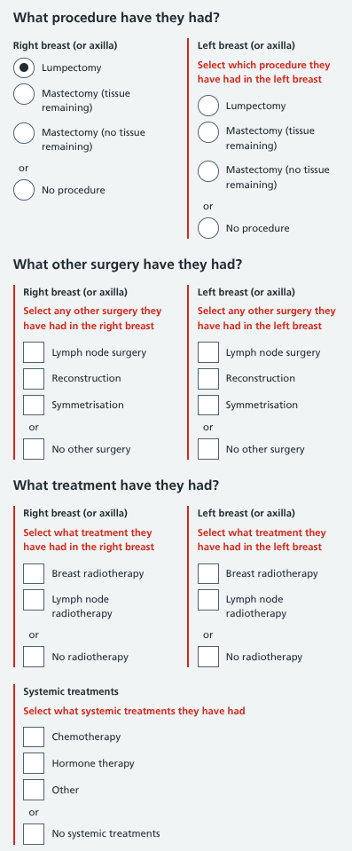
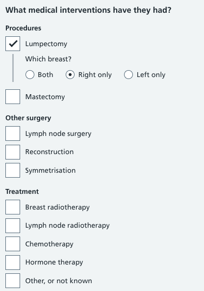
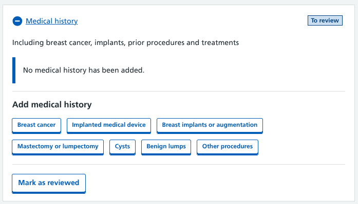
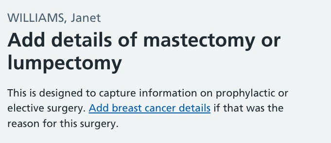
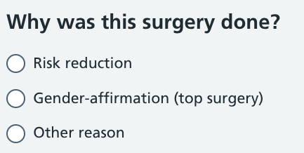
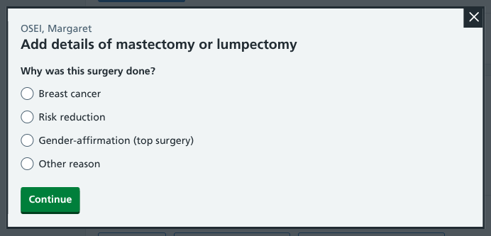
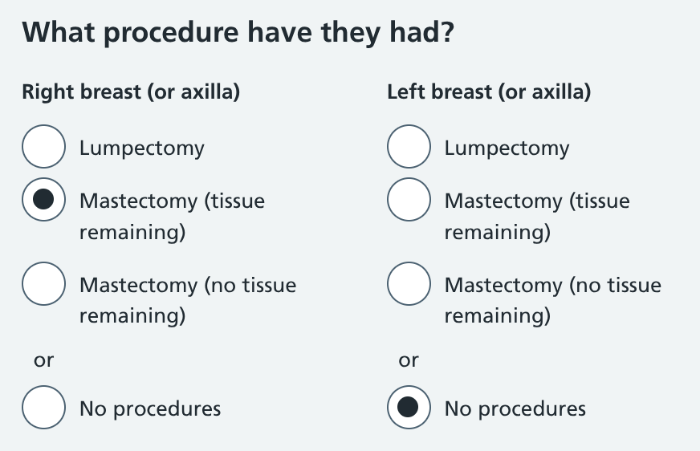
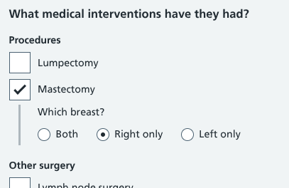
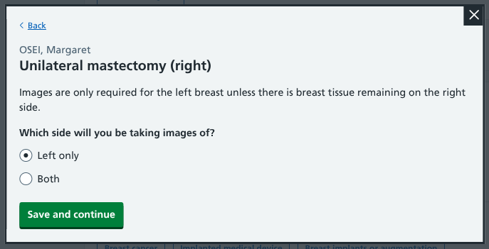
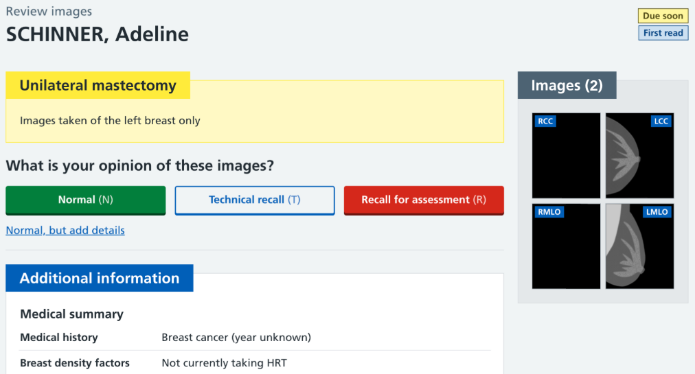

We’ve made some updates to our medical history forms to make data entry more efficient, help clear up some misunderstandings, and add new paths depending on the information entered. 

## Improving inefficiencies

Some of our medical history forms require users to record what procedures or treatment the participant has previously had. We collect this information then pass it to images readers along with the mammograms to help with their assessment of the case.

Our initial designs laid the options out in two columns (right and left), and asked users to say what has (or hasn't) been done on each side. Read our [Capturing medical history](/manage-breast-screening/2025/09/capturing-medical-history/) design history for more background context.

During testing we've discovered this was creating frustration for users. We were forcing them to answer questions for both breasts, even when a participant had only had a procedure on one side.

<figure class="nhsuk-image">
  

    
  

  <figcaption class="nhsuk-image__caption">
    A typical scenario when adding details of previous breast cancer in the right breast that was treated with a lumpectomy. The user would see six validation errors unless they made a selection for all questions on both sides.
  </figcaption>
</figure>

We'd provided a comprehensive set of options to cover every scenario, but the screen was cluttered with a mass of inputs and repeated label text which made it cumbersome to use in a live screening.

### Moving to a 'pick a thing, then a side' pattern

To reduce friction, we've replaced the two-column grid with a single list of procedures and treatments.

Users simply need to select what happened and then (where relevant) state on which side it was done.

This significantly cuts down on the number of clicks required from users to record the information, as well as being more pleasing on the eye.

<figure class="nhsuk-image">
  

    
  

</figure>

We've applied this one-column solution on all the forms that collect information on medical interventions (breast cancer, breast implants, mastectomy or lumpectomy, and benign lumps).

## Clearing up mastectomy confusions

Our user research also uncovered two confusing elements related to these forms that we needed to rectify. In our prototype there were:

1. different ways to add a mastectomy (depending on the reason it was done)
2. different types of mastectomy

### 1. Different ways to add a mastectomy

A mastectomy is one of the treatment options following a breast cancer diagnosis. But there are other reasons why someone may have a mastectomy, such as reducing cancer risk or as a part of gender transition.

We present these as separate things to add within our medical history section.

We'd also added a note at the top of the mastectomy or lumpectomy form to direct users towards the breast cancer form if they'd started off on the wrong path.

But users don't always read every line of text that's put in front of them.

That meant some users were completing details of past instances of breast cancer on a form that didn't have many of the essential fields (such as details of other surgery and treatments).

They were also confused when reaching this question:

<figure class="nhsuk-image">
  

    
  

</figure>

So rather than having this at the end of the process, we've decided to ask it first as a separate step, and add in breast cancer as one of the options.

If breast cancer is selected, we divert users to the breast cancer form. If any of the other reasons are chosen they continue with the rest of the elective mastectomy or lumpectomy questions.

### 2. Different types of mastectomy

After a mastectomy it may still be necessary for a participant to have breast cancer screening. Even though the procedure removes the majority of the breast, there's still a chance cancer could develop in any remaining tissue.

Our original forms had a way for users to say if there was any tissue to scan or not.

The purpose of this was to establish if images needed to be taken. If not, we planned to design something that would advise against taking images of that side, avoiding any unnecessary radiation exposure for the participant. But this is not a black and white distinction based on the presence of tissue alone. 

There is some residual tissue left behind after pretty much every mastectomy. It's down to the mammographer to decide whether images need to be taken or not.

Our updated forms simplify this into a single selection.

<figure class="nhsuk-image">
  

    
  

</figure>

## New unilateral and bilateral mastectomy paths

Now we have a cleaner way to capture mastectomy information, we're able to introduce follow-up questions to determine imaging requirements.

After recording a mastectomy (either through the breast cancer or elective surgery form) we ask users which images they are planning to take.

If the surgery was done on one side only (unilateral), the default selection is to just take images of the other side. If necessary, users can change this and provide a reason.

If a mastectomy has been done on both sides (bilateral) then we advise that no images need to be taken. Continuing will end the appointment with an 'Attended not screened' status added.

Users can decide to change the selection and take images of either or both sides.

### Showing this at image reading

We want it to be immediately clear to users looking at mammograms why they may not be seeing the regular set of four images.

Most medical information is shown in a summary below the opinion options, but for mastectomy information we feel it's justified to show this as a warning containing any details provided by the mammographer during the screening appointment.

Different image combinations can be expected in different scenarios. For example, if there's a unilateral mastectomy on the right side the mammographer may take two images of the left breast, but only a CC on the right. Or if there's a bilateral mastectomy the mammographer may take LCC and RCC images, but no MLOs.

We need to update our prototype to reflect the real-world situations encountered by our users and put these updates in front of them to see if we've effectively addressed the issues they had identified.

As well as addressing any feedback, the next iteration of this update will include solutions for:

- displaying image thumbnails during reading when there are only images of one breast to consider
- updating our opinion paths (technical recall and recall for assessment) so they don't include components related to the breast that has been removed
