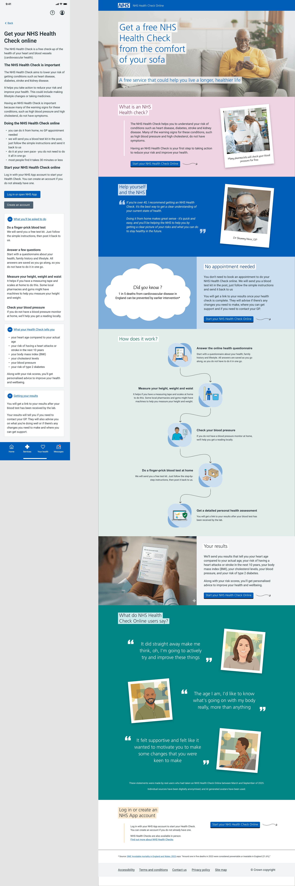

## Context and problem

When users access an invite link to complete their NHS Health Check online from outside the NHS App, they land on a public-facing entry page which we tend to refer to on the team as the “Logged Out Homepage”. 

The original version of this page relied strictly on standard components from the NHS Design System. One might characterise this as an ‘information first’ approach. The result was (naturally) largely plain text detailing what the Health Check online is, who it is for, and how it works. Although the content was refined and improved over several iterations, this remained a significant drop-out point for the service, with only around 40-50% of users continuing past this point, and the challenge was to improve on this performance. 

Our hypothesis was that this approach treated the landing page more like an instruction manual rather than a motivating service gateway, creating cognitive load through the perceived volume of text but without generating early emotional engagement or perceived value.

## Moving to an "engagement-first" approach

Recognising that this page sits outside the signed-in service boundary, we had the creative freedom to step away from standard layout and content components. We set out to transform the page from a straightforward text document into a more narrative-driven experience that aims to guide the user smoothly down the page and towards a conclusion that encourages conversion. 

We incorporated several key behavioural design patterns: 

1. **Anticipated value & visual storytelling:** Introducing a welcoming lifestyle hero image and heading ("Get a free NHS Health Check from the comfort of your sofa") helps to set a positive tone while beginning to establish the value of the service. 
2. **Simplified step-by-step flow:** Replaced bullet points with an intuitive, illustrated vertical flow map showing how the health check process works in its entirety. 
3. **Social proof, evidential proof & authority bias:** We integrated real-world quotes taken from UR sessions into the page, together with a persuasive statement from our GP Clinical Lead, Dr Shammy Noor. We also included an easy-to-understand ‘factoid’ to add support for the concept of getting a health check. 
4. **Curiosity & chunking:** One significant challenge was judging how far to step away from the standard NHS design components. Referencing other NHS services that leverage a unique visual style as a means of defining a slightly separate identity from the rest of the NHS, we used distinct visual containers, a colour palette derived from the standard NHS palette, and matched unique heading typography to standard body copy styles. These panels, quotes and captioned images help to create bite-sized value propositions, breaking up complex clinical details into consumable, high-impact pieces of information. 

## Results and impact

By shifting the approach away from simply delivering clear information to one of actively driving engagement with the content, both visually and structurally, telling a story and building anticipation, the metrics shifted dramatically. 

Over the months since the launch of the new page, conversion has jumped significantly, to a 70-80% click-through rate over any two-week period, representing somewhere around a **30% increase** in conversion rate. 

## Next steps

Our next challenge is to find ways to understand the user journey following on from this point, where we are seeing a significant drop-out of users during the sign-in process.

