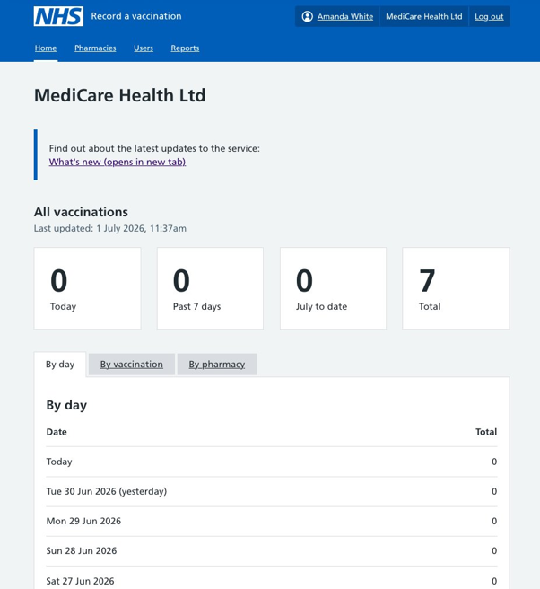
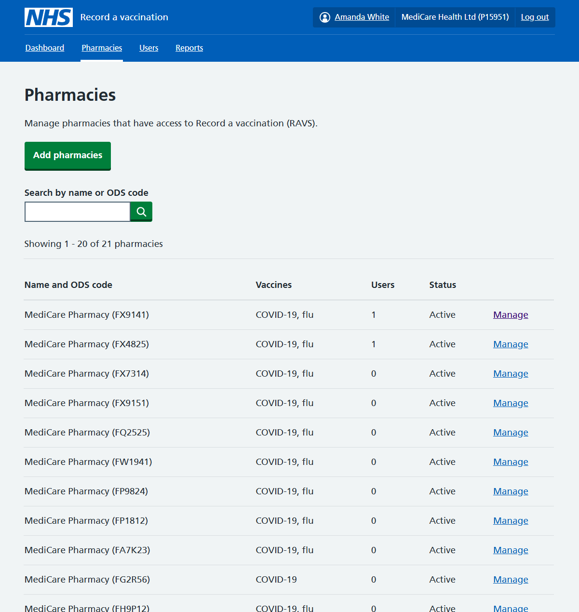
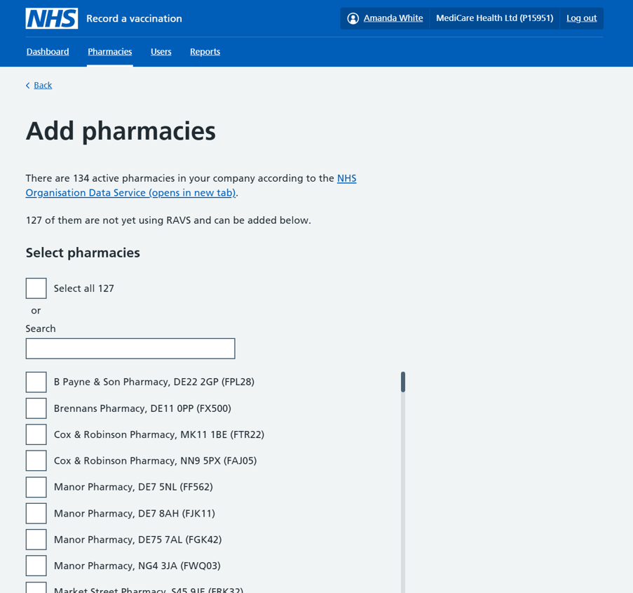
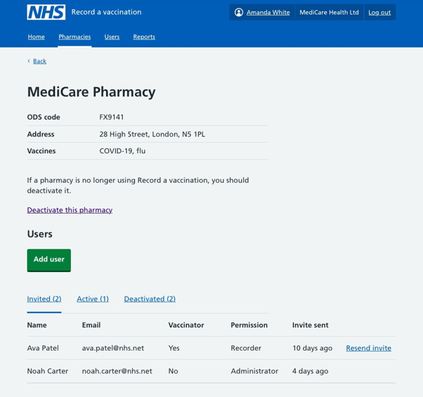
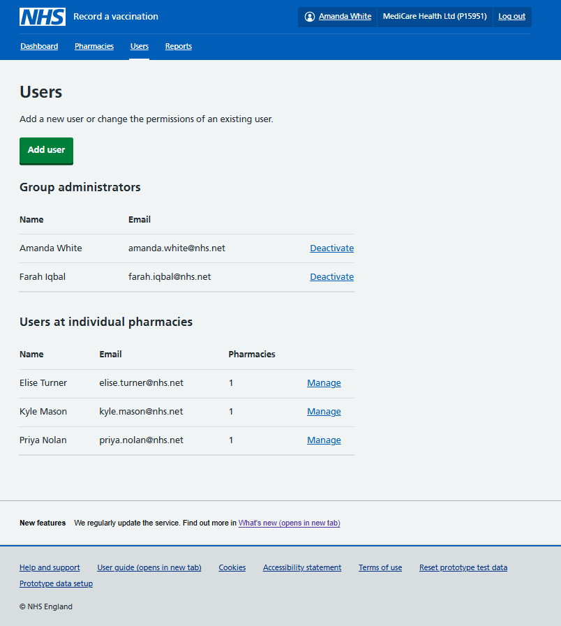
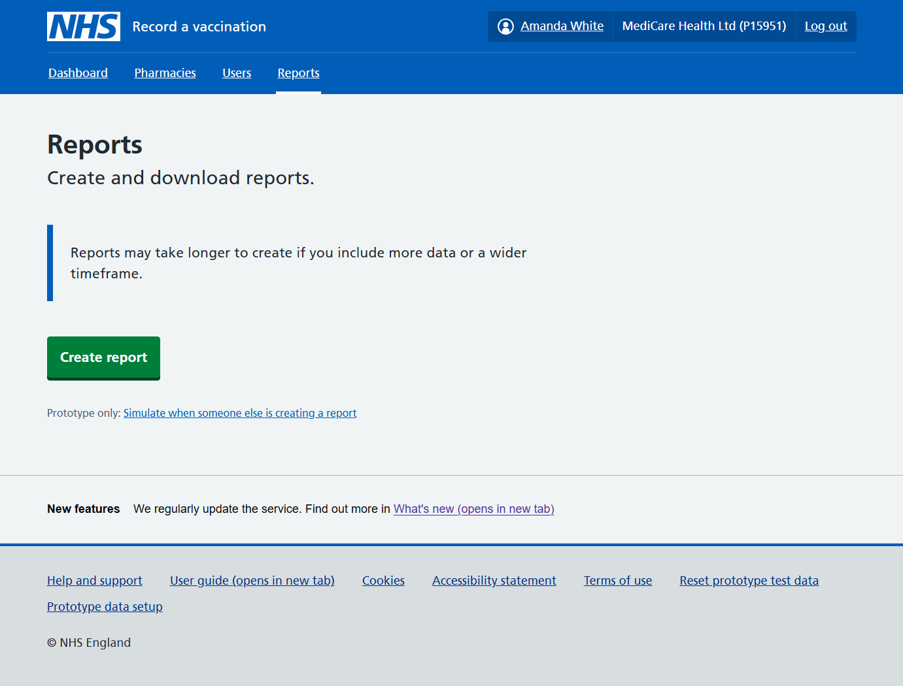
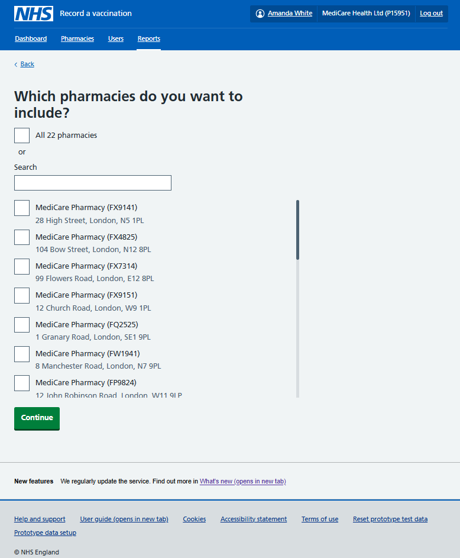
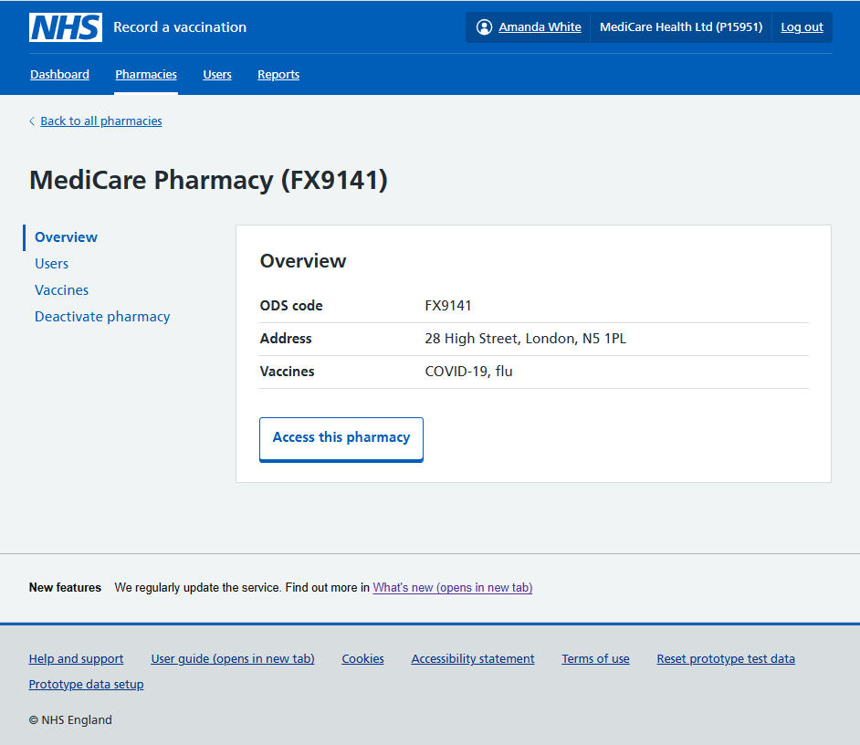

How we created a new interface and a new permission level in RAVS for teams who work in the head office of a pharmacy chain. 

## Background

In trying to meet the needs of pharmacy chains, we did 2 rounds of [design and user research focusing on bulk onboarding](/record-a-vaccination/2026/10/meeting-pharmacy-chain-needs/). 

But we then decided to rethink our approach as it became increasingly clear that "head office teams" also wanted:

- to have a central view of operations after onboarding
- an ongoing ability to manage pharmacies and users
- the functionality to report on vaccination data across their branches

## A new admin interface
We explored creating an interface specifically for users who have company-wide responsisbilities where they could not only onboard their pharmacies but also manage users and create reports. 
This involved creating a different view of RAVS which we've been calling the "admin interface", and a new user type or permission level of "group administrator".  

In our new designs, a group administrator logging into RAVS for their pharmacy chain has access to 4 sections:

1.	A **Dashboard** showing high-level vaccination data for all the pharmacy branches in their company.

2.	A **Pharmacies** section listing all their branches using RAVS, and the number of users at each branch with options to add more pharmacies, and to manage users at an individual pharmacy.

3.	A **Users** section where they can view and manage all their users, including other group administrators. In this section a user can be added to several pharmacies in 1 go.
   

4.	A **Reports** section, where they can create a report that includes vaccination data from all their branches.

## Feedback from user research
Overall, participants from large pharmacy chains were very positive about the new designs. 

-	Being able to run reports across all their branches and manage pharmacies plus users centrally was universally popular and considered a great timesaver. 
-	Adding pharmacies and users (onboarding) was considered intuitive.
-	Participants appreciated having visibility and some control of their pharmacies and users within RAVS – for example the option to add more users or reactivate users.

They suggested several changes that would make the admin interface even more useful.

-	They thought the dashboard could meet all their basic reporting needs instantly if it showed the number and type of vaccinations done by each pharmacy and by timeframe. 
-	They told us that some of the timeframes you can currently select when you create a report are not useful, such as last 7 days, last 14 days and last 31 days. It would be more useful to have last calendar week (previous Monday to Sunday) and last calendar month.
-	As well as being able to reactivate individual users 1 at the time, they'd like a way of reactivating all users across all their branches at the start of a campaign. 
-	A couple of participants observed that there was no way of adding a vaccination programme which is something they'd like to be able to do centrally.

Most participants said they would still want to be able to access RAVS at individual branches, for example to investigate an issue or make a correction to a record. 

## Iterations to the CP admin interface

Following this round of UR, we made some further changes to the designs, including:

-	changes to the timeframes users can select for reports – specifically adding last calendar week and last calendar month and removing the options of last 7 days, last 14 days and last 31 days 
-	adding the functionality for a group admin to access an individual branch directly, as if they were a lead admin at that pharmacy – which would enable them to view and amend vaccination records recorded by that branch 

We decided not to address any changes to the dashboard until users had an opportunity to use it and we'd obtained further feedback.

## Onboarding happened sooner than expected and not as planned[EE5.1]
We had been aiming to get our new CP admin interface, or at least a version of it, live by the end of August ahead of the busy flu and COVID-19 autumn/winter vaccination campaign – to make it easier for chains to sign up for RAVS. 

But due to the launch of the national MenB campaign in July 2026 and the accompanying requirement for participating pharmacies to record MenB vaccinations in RAVS, a huge number of pharmacies suddenly needed to onboard to RAVS before we had time to develop the new interface.
Despite our various efforts to design a way for chains to bulk onboard their branches themselves, we ended up with only the existing sign-up form being available which could only be used to sign up 1 pharmacy at the time. 
Because we knew how onerous it would be for the large chains to use the existing form, we offered to help in another way. We contacted all the chains with 40 plus pharmacies and told them that if they gave us a list of all the pharmacies and associated lead admins they wanted to onboard, we would do it for them. Our dev team was able to run a script to add these pharmacies and users in bulk to RAVS. 

Several chains took up this offer though others signed up their branches individually using the sign-up form despite the effort involved. 

## Making the admin interface available to users
When it came to developing the admin interface, we decided to prioritise the Reports section so that we could make this section available to users as soon as possible. 

Since the chains had ended up onboarding to RAVS without the admin interface, enabling them to sign up pharmacies and users was less of an immediate need. 

On the other hand, now that the chains had started recording MenB vaccinations, they would want to run reports across all their branches by the end of the first month of vaccinations. 
In August 2026, we went live with a simplified version of the interface that included the Reports and the Pharmacies sections, but not the Dashboard or Users sections.
The initial version of the Pharmacies section showed all the pharmacy branches that were signed up to RAVS, and all users at these branches including their permissions. But it did not include the functionality to add users or change a user's status or permissions.  
But critically in the Reports section, a group admin could run a report that includes vaccination data across all their branches. 

In October 2026, we released a first version of the Users section, enabling group admins to see all group admins at their company and to add more group admins.

## What's next
We are planning to make a full version of the CP admin interface available over the next few months, releasing additional features in increments. 
