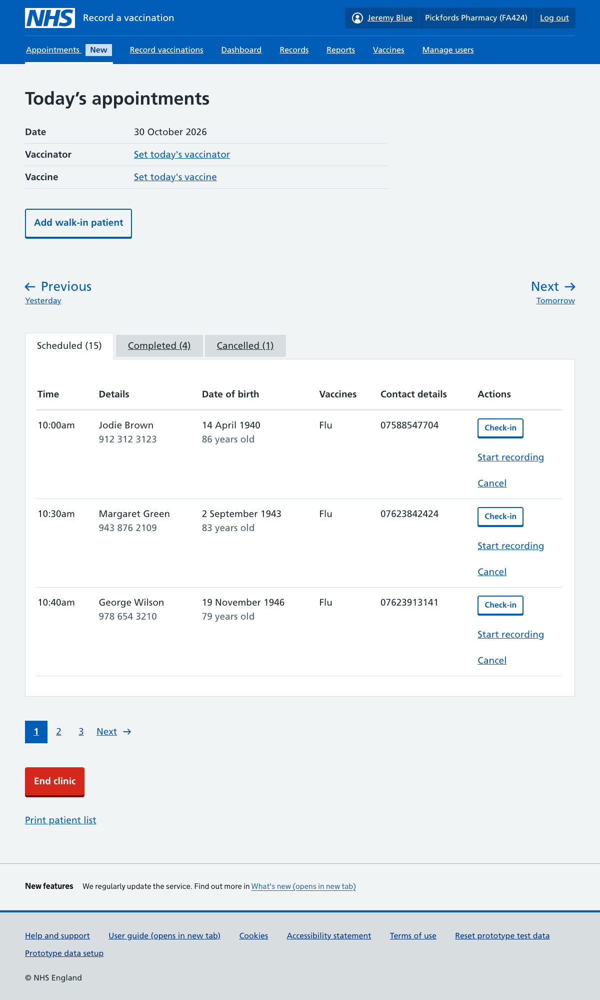
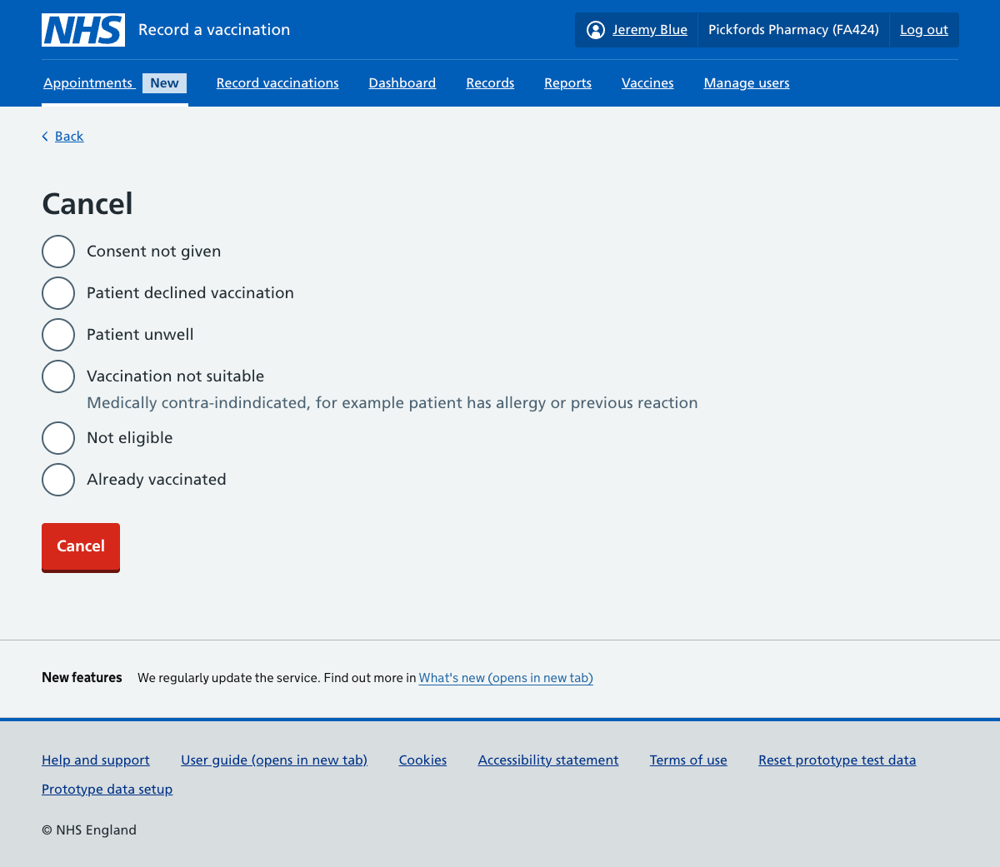
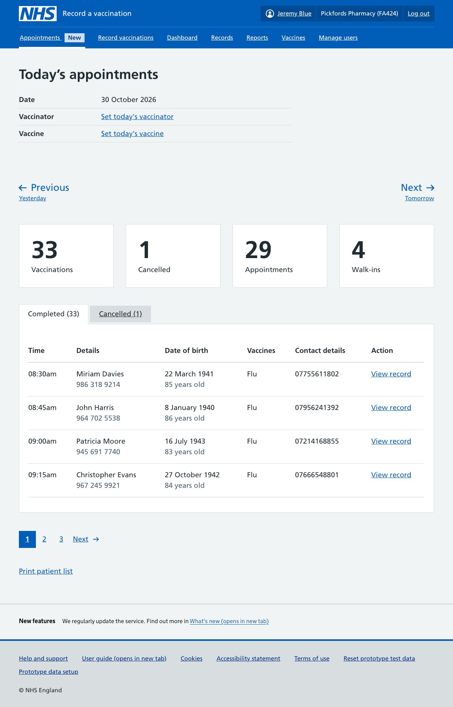
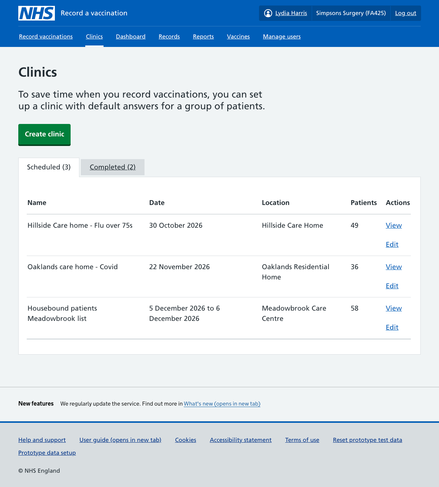
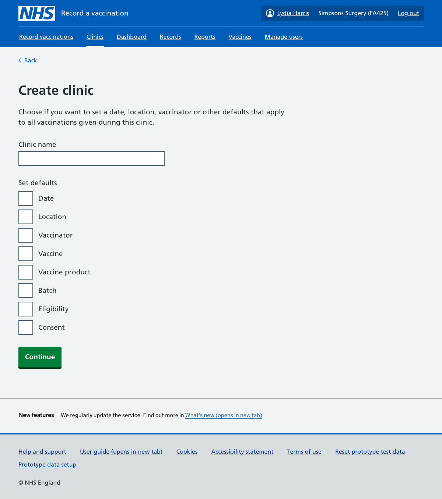
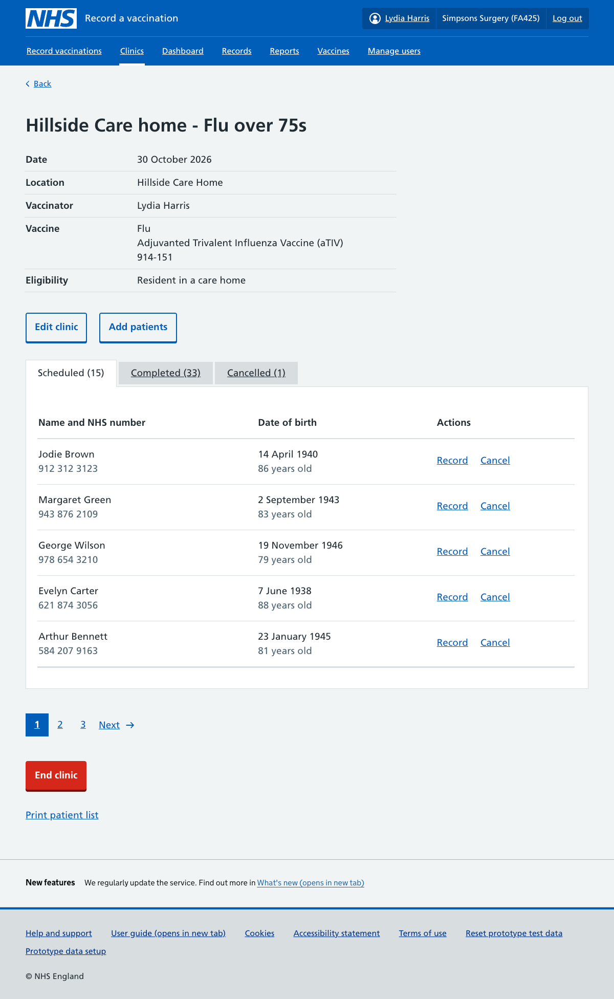
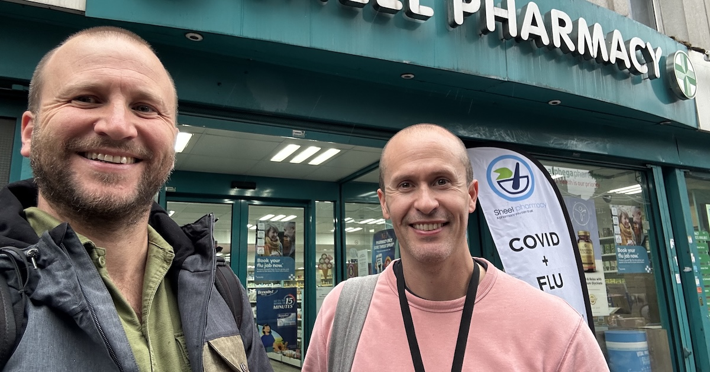

{{ description }}

## Kick-off

In September we explored a new way to help RAVS users in mass vaccination sessions or clinics. For example, a flu vaccination clinic in a care home for older people.

By clinic, we mean a vaccination setting or session where many patients are getting vaccinated at the same time, often receiving the same vaccination.

During these vaccination sessions, most of the answers RAVS requires will be the same for each patient e.g. vaccinator, batch number, eligibility, setting don’t change. The repetition is inefficient and may draw focus away from the patient.

Previous user research & feedback had highlighted this was a problem for users, but we needed to pull it together into a new concept.

Our user researcher led some kick-off sessions, where we reviewed & shaped the problem; inviting people from across RAVS, and related teams.

These are some of the initial user needs we decided to explore:

- I need to be able to get records ready before a clinic or visit, so I spend less time entering information with the patient.  
- I need to avoid entering the same information again and again when vaccinating several patients in the same session.  
- I need other members of the team to add information before I see the patient, so I can focus on the vaccination, and see more patients.  
- I need RAVS to work on the device I have access to (which may be laptop, tablet or personal smart phone).

## Thinking about tasks and scenarios

Next, we started to plan our prototype. So that we could narrow the scope a bit, we came up with some scenarios to explore:

1. Pharmacies whose patients have booked an appointment
2. Hospital trusts who offer walk-in clinics
3. GPs who do care home visits, where the patients are known in advance

For each scenario we identified groups of tasks that could be done at different stages. Not all scenarios would need or benefit from every task, but thinking about them in this way helped us to see how the effort of recording vaccinations could be shifted to earlier in the journey or shared between different roles.

Our initial list of stages:

1. Prepare in advance
2. Check-in on the day
3. See who's next
4. Vaccinate
5. See a final report

## Creating the prototype

We ended up creating two prototypes.

### Pharmacy appointments prototype

One for pharmacy appointments that enhanced our upcoming appointments iteration. It explored the following ideas:

- patient check-in
- add walk-in patient
- set defaults for the day
- partial save – which could enable recording to start before the patient enters the consultation room
- capture cancellation reason

### Care home clinic prototype

The other prototype we created focused on the care home clinics scenario. This prototype was similar, but explored how users might set up a clinic to save them time later. This prototype allowed them to:

- set default answers for the whole clinic
- pre-load a list of patients in advance
- capture a cancellation reason

## What we learnt from user research

For our user research round, we decided to do a mix of remote video calls with GPs, hospital trusts and pharmacies. We also planned a day of face-to-face sessions at pharmacies around London. All together, we had about 14 sessions.

We learnt that, for small community pharmacies, the concepts in the prototype didn’t offer that much value. Since we already have an appointments feature in the backlog, we’ve decided to focus on releasing that first and then revisiting these ideas later.

However, the clinics prototype was more successful. We’ve decided to take this forward with a focus on helping GPs to create flexible presets and patients lists when vaccinating in housebound and care home settings.  

Our next step will be to create another, more focused, prototype so we can do further user research and usability testing.

